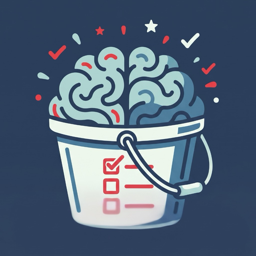

# BrainDump

<p align="center">
  
</p>

A native macOS menubar todo list app. Lives in your status bar, stays out of your way.


## Features

- **Menubar-first** — click the checklist icon to open a popover; no Dock icon
- **Live badge count** — active item total shown directly in the menu bar
- **Lists** — organize todos into named, color-coded categories
- **Tags** — apply multiple colored badge tags to any todo
- **Search** — filter by title, notes, or tag name across the current list
- **Archive** — soft-archive completed or old items; restore or bulk-clear any time
- **Due dates** — optional date with relative display; overdue items highlighted in red, today's items in orange
- **Colorization** — assign a color to items, lists, and tags from a 10-color palette
- **Persistent** — all data saved locally as JSON; no account, no cloud, no network

## Requirements

- macOS 15 or later
- Swift 6 Command Line Tools (`xcode-select --install`)

No third-party dependencies.

## Installing

Pre-built, versioned downloads (`.zip` and `.dmg`) are published on the
[Releases page](../../releases) for every tagged version. Grab the latest
release, open the `.dmg` (or unzip the `.zip`), and drag `BrainDump.app`
wherever you like.

If a release isn't codesigned/notarized yet, Gatekeeper will warn on first
open ("Apple could not verify ... is free of malware"). To open it anyway:

- **Finder:** right-click (or Control-click) `BrainDump.app` → **Open** →
  confirm **Open** in the dialog, _or_
- **System Settings:** Privacy & Security → scroll down to the blocked-app
  notice → **Open Anyway**, _or_
- **Terminal:** strip the quarantine flag that triggers the warning:

  ```bash
  xattr -cr /path/to/BrainDump.app
  ```

Prefer to build it yourself? See [Build & Run](#build--run) below.

## Build & Run

```bash
# Clone
git clone <repo-url>
cd todos

# Build and launch (app appears in your menu bar)
swift run
```

Press `Ctrl-C` in the terminal to quit, or use the power button inside the popover.

For iterating quickly, `swift run` rebuilds only changed files — typical incremental builds are under a second.

## Package as a standalone app

```bash
# Debug .app (fast, for local testing)
./scripts/bundle.sh
open BrainDump.app

# Optimised release .app
./scripts/bundle.sh release
open BrainDump.app

# Release + codesign (requires Apple Developer ID)
./scripts/bundle.sh release sign "Developer ID Application: Your Name (TEAMID)"
```

`BrainDump.app` is produced in the project root. It has `LSUIElement = true` so it runs without a Dock icon.

### Distributing

| Method | Steps |
|---|---|
| Direct download | Zip `BrainDump.app`, notarise with `xcrun notarytool`, share the zip |
| DMG | `brew install create-dmg && create-dmg --app-drop-link 400 150 BrainDump.dmg BrainDump.app` |
| Homebrew Cask | Add to a tap; write a Cask formula pointing at a notarised zip |

## Data

All todos are stored at:

```
~/Library/Application Support/BrainDump/data.json
```

The file is plain JSON and written atomically after every change. You can back it up, inspect it, or migrate it freely.

## Project structure

```
braindump/
├── Package.swift               # SPM manifest — zero external dependencies
├── Sources/BrainDump/
│   ├── BrainDumpApp.swift      # App entry point, MenuBarExtra scene
│   ├── Models/
│   │   ├── TodoStore.swift     # All state + JSON persistence
│   │   ├── TodoItem.swift      # Codable item model
│   │   ├── TodoList.swift      # Codable list model
│   │   └── Tag.swift           # Codable tag model
│   ├── Views/
│   │   ├── MainContentView.swift
│   │   ├── TodoRowView.swift
│   │   ├── TodoDetailView.swift
│   │   ├── ListSidebarView.swift
│   │   ├── ArchiveView.swift
│   │   ├── TagBadgeView.swift
│   │   └── SearchField.swift
│   └── Utilities/
│       └── ColorHex.swift      # Hex ↔ Color, palette picker
├── scripts/
│   └── bundle.sh               # .app packaging script
├── .github/workflows/
│   └── release.yml             # Tag-triggered build + publish to GitHub Releases
├── docs/
│   └── RELEASING.md            # Versioning policy + release process
├── AGENTS.md                   # Developer and AI-agent instructions
└── CHANGELOG.md
```

## Contributing

See [AGENTS.md](AGENTS.md) for architecture notes, build commands, and coding conventions.
See [docs/RELEASING.md](docs/RELEASING.md) for how versioning and releases work.
