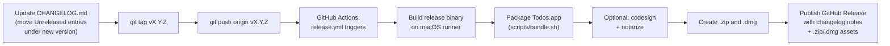

# Releasing Todos

This document describes how versioning and releases work for Todos, and how
to cut a new release.

## Overview



A release is entirely driven by **pushing a git tag**. There is no manual
build-and-upload step and no separate "bump version" commit — the tag itself
*is* the version.

## Versioning policy

Todos uses [Semantic Versioning](https://semver.org/) (`MAJOR.MINOR.PATCH`):

- **MAJOR** — breaking changes to the data file format that require manual
  migration, or major UX overhauls.
- **MINOR** — new features, new views, non-breaking model changes (e.g. new
  optional `Codable` fields).
- **PATCH** — bug fixes, visual tweaks, performance improvements.

The version lives in exactly one place: the git tag (e.g. `v1.3.0`). It is
not hard-coded anywhere in Swift source or `Package.swift`. At build time,
[scripts/bundle.sh](../scripts/bundle.sh) reads the `VERSION` environment
variable (stripped of its `v` prefix) and writes it into the app bundle's
`Info.plist` as both `CFBundleShortVersionString` (e.g. `1.3.0`) and a
derived numeric `CFBundleVersion`.

Local/dev builds (`./scripts/bundle.sh` without `VERSION` set) fall back to
`0.0.0-dev` and are never published.

## Maintaining CHANGELOG.md

[CHANGELOG.md](../CHANGELOG.md) follows [Keep a Changelog](https://keepachangelog.com/en/1.1.0/):

- As you land changes, add bullet points under the `## [Unreleased]` heading
  at the top of the file, grouped under `### Added` / `### Changed` /
  `### Fixed` / `### Removed` as appropriate.
- When you're ready to cut a release, rename `## [Unreleased]` to
  `## [X.Y.Z] - YYYY-MM-DD` (matching the tag you're about to push, without
  the `v` prefix), and add a fresh empty `## [Unreleased]` heading above it
  for the next round of work.

This matters functionally, not just cosmetically: the release workflow
extracts the section between `## [X.Y.Z]` and the next `## [` heading and
uses it verbatim as the GitHub Release notes body. If no matching section
exists, the release is still published, but with a placeholder note.

## Cutting a release

1. Make sure `main` is green and `CHANGELOG.md` has a `## [X.Y.Z] - YYYY-MM-DD`
   section for the version you're releasing (see above).
2. Tag and push:

   ```bash
   git tag vX.Y.Z
   git push origin vX.Y.Z
   ```

3. Watch the **Release** workflow run in the repo's **Actions** tab (or
   `gh run watch`). It will:
   - Build a release binary (`swift build -c release`)
   - Bundle it into `Todos.app` with the correct version
   - Codesign and notarize it, if the signing secrets below are configured
   - Package `Todos-X.Y.Z.zip` and `Todos-X.Y.Z.dmg`
   - Create a GitHub Release at tag `vX.Y.Z` with those two files attached
     and the matching `CHANGELOG.md` section as the release body
4. Once the run finishes, check the new release under the repo's **Releases**
   page and confirm the assets download and open correctly.

If a release run fails partway through, delete the tag (`git push --delete
origin vX.Y.Z && git tag -d vX.Y.Z`), fix the issue, and re-tag.

## Codesigning and notarization (maintainers only)

The release workflow produces a working, installable (if unsigned) build
even with no secrets configured — this keeps the project buildable by
anyone who forks it. To produce a codesigned and notarized release (required
for distribution outside of "right-click → Open" / Gatekeeper warnings),
configure these repository secrets under **Settings → Secrets and
variables → Actions**:

| Secret | Description |
|---|---|
| `MACOS_CERTIFICATE_P12_BASE64` | Your "Developer ID Application" certificate and private key, exported from Keychain Access as a `.p12`, then base64-encoded (`base64 -i cert.p12 \| pbcopy`) |
| `MACOS_CERTIFICATE_PASSWORD` | The password used when exporting the `.p12` |
| `DEVELOPER_ID_APPLICATION` | The signing identity string, e.g. `Developer ID Application: Your Name (TEAMID)` (find via `security find-identity -v -p codesigning`) |
| `APPLE_ID` | Apple ID email used for notarization |
| `APPLE_TEAM_ID` | Your Apple Developer Team ID |
| `APPLE_APP_SPECIFIC_PASSWORD` | An [app-specific password](https://support.apple.com/en-us/102654) for `APPLE_ID`, used by `notarytool` |

When all of these are present, the workflow additionally:

1. Imports the certificate into a temporary CI keychain
2. Codesigns `Todos.app` with the hardened runtime enabled
3. Submits the built `.zip` to Apple's notary service and waits for approval
4. Staples the notarization ticket to `Todos.app` and re-packages the `.zip`

If any secret is missing, these steps are skipped automatically (the
workflow checks for `MACOS_CERTIFICATE_P12_BASE64` as the gate) and the
release proceeds unsigned.

## Building and notarizing manually (local)

You can reproduce the signed/notarized path locally without CI:

```bash
# Build, bundle, and sign
VERSION=1.3.0 ./scripts/bundle.sh release sign "Developer ID Application: Your Name (TEAMID)"

# Zip and notarize
ditto -c -k --keepParent Todos.app Todos.zip
xcrun notarytool submit Todos.zip --keychain-profile <profile> --wait
xcrun stapler staple Todos.app

# Package a DMG
brew install create-dmg
create-dmg --app-drop-link 400 150 Todos.dmg Todos.app
```

See `xcrun notarytool store-credentials` to set up a reusable
`--keychain-profile` locally.

## Pre-releases

For a release candidate or beta, use a pre-release tag suffix, e.g.
`v1.4.0-rc1`. The workflow will still build and publish normally; GitHub
Releases created this way should be manually marked as a "pre-release" in
the GitHub UI after creation (or extend the workflow to pass `--prerelease`
to `gh release create` when the tag contains a hyphen).
